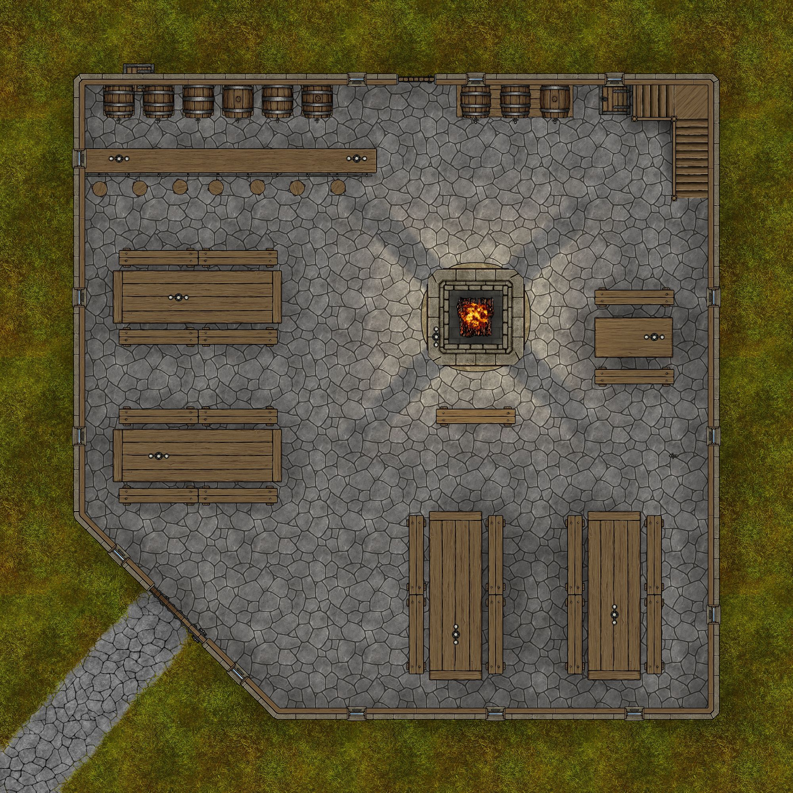
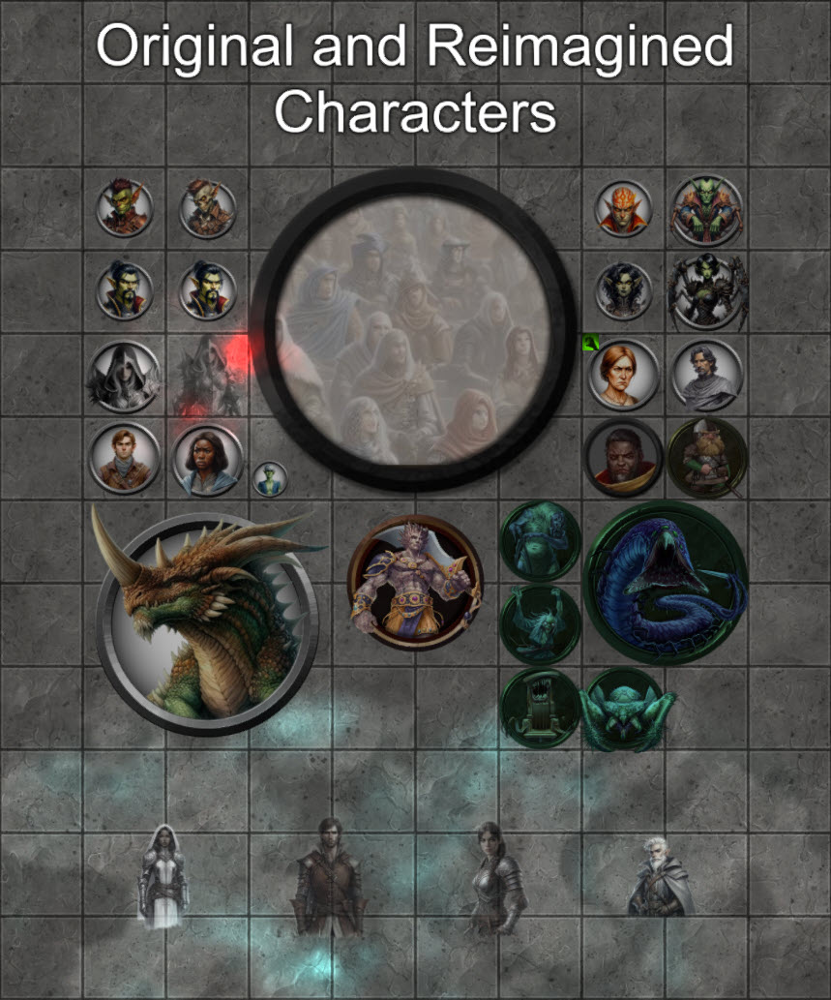

<h1>Wednesday, August 19, 2026</h1>

I have made the difficult decision to stop supporting this module, at least for now.

My reason for creating this module was to first, learn as much as I can about Foundry modules and second, to flesh out a setting that I loved. Since it is a free module, I used AI art. I am a writer first, and an artist second. I never use AI to write any of my modules. But for modules like this one, the availability of AI art greatly enhanced what I was able to do. 

My use of AI art means this module no longer complies with <a href="https://foundryvtt.com/article/ai-policy/"> Foundry's AI Art Policy</a>. It is not clear whether or not the policy applies to free modules like this one, but I decided to concentrate my efforts on my upcoming modules.

At some point in September, I expect Foundry to remove this module from their marketplace. By leaving this module as it is, I will not be stripping any art from your installations, and it will be available until you decide to remove it.

I am working to increase my art skills, especially with watercolors. It is a difficult medium, but has a particular glow that is lacking in other mediums. My first premium module will include some of my watercolors and zero AI art. For my modules set in Otari, I used AI art because it was expedient. It did not displace an artist because without AI art, I simply would have shipped it without any art except maps.

I am not sure if this decision is permanent. The word of AI is changing everyone's jobs, including my day job in information technology. I do not expect the job of an artist to be excluded. Already, Adobe has built AI tools into their products and it will become difficult for any digital artist to avoid it. Artists will start incorporating AI workflows into their creation process just to remain competitive, just as I had to do as an analyst, and as any software developer now needs to do in order to remain employable.

This decision impacts Tianze's Otari Extras and Tianze's Gauntlight Extras. I will go ahead and update <a href="https://github.com/tianevitt/tianzes-landing-page">Tianze's Landing Page</a> to version 14 with new and compliant artwork.

<h2>September 20, 2025 - V13 and Scene Regions</h2>
Finally updated to V13, plus I took advantage of the new scene regions, and the light effect that beats to the sound of the ambient lights. 

If the scene regions appear too dark on your map, use GM Vision. See the journals for more info.
Enjoy!

Assets shipped with this module were created using several tools:

<ul>
    <li>
        
Original maps were created with <a href="https://dungeondraft.net/">DungeonDraft</a> using assets from <a href="https://www.forgotten-adventures.net/">Forgotten Adventures</a>.

    </li>
    <li>
        
Vignettes, character art and tokens were created using any of these:

        <ul>
            <li>
                
<a href="https://www.bing.com/images/create">Bing Image Creator</a>

            </li>
            <li>
                
<a href="https://affinity.serif.com/en-gb">Affinity Designer and Photo</a>

            </li>
            <li>
                
<a href="https://www.faststone.org/">Faststone Image Viewer</a>

            </li>
            <li style="box-sizing:border-box;user-select:text">
                
<s>HeroForge</s>

            </li>
        </ul>
    </li>
</ul>
<h2>Overview</h2>

This module includes:

<ul>
    <li>
        
New original scenes for:

        <ul>
            <li>
                
Dawnflower Library

            </li>
            <li>
                
Rowdy Rockfish

            </li>
            <li>
                
Secluded Clearing

            </li>
            <li>
                
Gauntlight Extras Landing, for theater of mind play.

            </li>
        </ul>
    </li>
    <li>
        
A new version of every scene that shipped with Abomination Vaults, up to Level 8, with soundscapes, additional lighting, gameplay suggestions, tiles, and map pins to relevant Abomination Vaults vignettes. These scenes point to the remade maps.

    </li>
    <li>
        
A journal that organizes every vignette that shipped with Abomination Vaults.

    </li>
    <li>
        
Journals detailing all changes to maps, including a comprehensive list of changes.

    </li>
    <li>
        
New actors for Otari, plus actors for each Otari citizen portrait (and associated token art) that shipped with Abomination Vaults.

    </li>
    <li>
        
New actors for the Gauntlight dungeons, including an alternate level boss, her allies, a Gamesmaster for the Arena, loot boxes, and a victim to rescue.

    </li>
    <li>
        
A competing adventurer gang, and their tragic story.

    </li>
    <li>
        
Ghostly versions of each member of the Roseguard, with skills and spells that persisted into their undeath, and their expanded story.

    </li>
    <li>
        
Convenient magic items to organize the many keys and books found in the Vaults, which will help preserve the gamemaster's sanity as well as the players.

    </li>
    <li>
        
A folder of effects for the various longterm afflictions the heroes may contract while on the adventure.

    </li>
    <li>
        
Reanimations of select once-killed monsters and bosses, handy for villains who like to raise dead.

    </li>
</ul>

Everything is organized in an Adventure compendium for easy installation.

<h2>Sample Map - The Rowdy Rockfish</h2>

<h2>Original and Reimagined Characters</h2>

